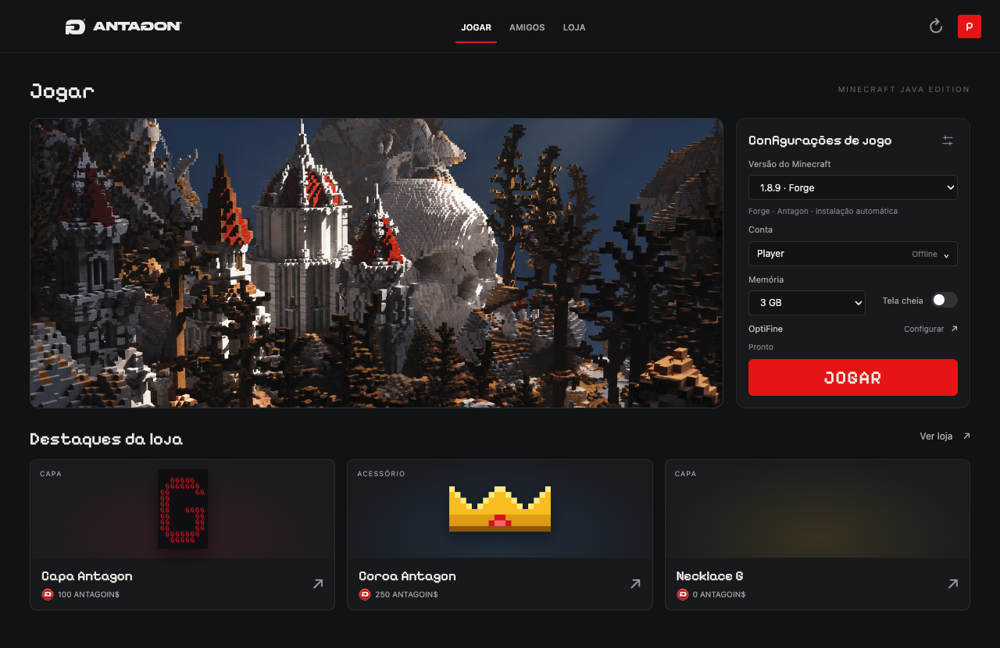
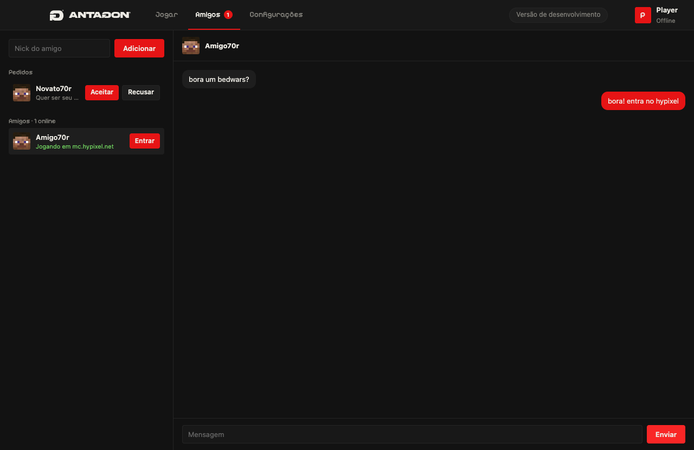
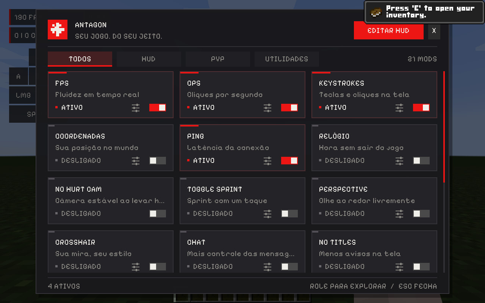
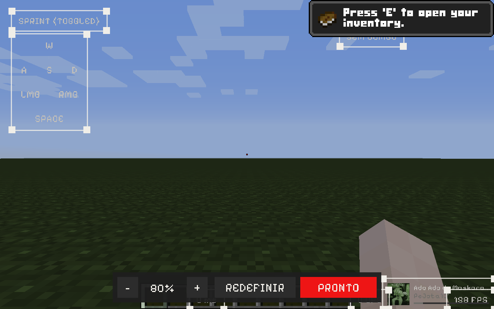
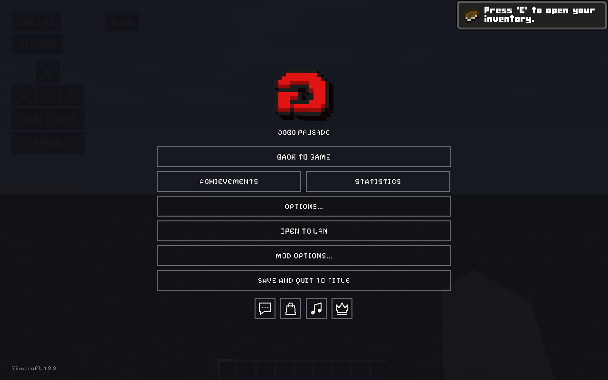
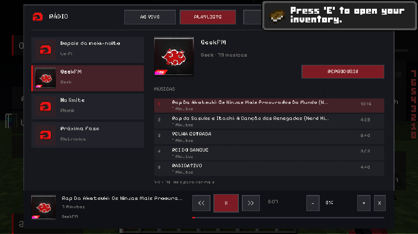

# Antagon Client

Client de Minecraft para **macOS e Windows**, com mods de PvP, cosméticos, amigos e rádio.
Escolha entre **Minecraft 1.8.9 com Forge** e a **versão estável mais recente com Fabric, Sodium e Iris**, personalize sua experiência e jogue com sua comunidade.



## Download

Baixe a versão mais recente em [Releases](https://github.com/voxesz/antagon-client/releases/latest):

- **macOS:** `Antagon-Client-macOS.zip`. Na primeira vez, clique com o botão direito no app → **Abrir**. Se o macOS disser
  que o app está danificado, rode `xattr -cr "/Applications/Antagon Client.app"` no Terminal.
- **Windows:** `Antagon-Client-Windows.zip`. Extraia e abra `Antagon Client.exe`. Se o SmartScreen avisar, clique em
  **Mais informações → Executar assim mesmo**.

O app não é assinado por uma conta paga da Apple ou da Microsoft, por isso os avisos na primeira abertura.

A partir da versão 0.1.2, o launcher confere se há versão nova no GitHub ao abrir e mostra o botão **Atualizar**.

| Amigos e chat | Mods no jogo |
| --- | --- |
|  |  |

| Editor de HUD |
| --- |
|  |

| Menu do jogo | Rádio no Minecraft 1.8.9 |
| --- | --- |
|  |  |

## Recursos

**Launcher**

- Conta Microsoft original ou nick offline
- Perfis separados para Minecraft 1.8.9 + Forge e a versão estável mais recente + Fabric (atualmente 26.3)
- Instala o jogo numa pasta isolada, preservando outros launchers, mundos e texturas
- Suporte a macOS Apple Silicon e Intel, com Java e bibliotecas nativas adequados à arquitetura
- Windows 10/11 x64, com instalação automática do Java necessário para cada versão
- Tela inicial com imagem personalizável, navegação centralizada, configurações de jogo e cosméticos em destaque
- Configurações completas pela engrenagem ao lado do botão de jogar
- Instalação guiada do OptiFine para 1.8.9; Fabric, Sodium, Iris, Lithium, FerriteCore e Essential automáticos no perfil mais recente
- Versões estáveis dos mods com resolução das dependências do Iris e substituição das versões antigas sem duplicatas
- Amigos: adicionar pelo nick, ver o que cada um está jogando, entrar no mesmo servidor e conversar (conta Microsoft)
- Atualização automática pelas Releases do GitHub
- Discord Rich Presence integrado, com controle de privacidade do servidor
- Loja de cosméticos com ANTAGOIN$: capas, Coroa Antagon em 3D e inventário associado à conta Microsoft (itens retirados
  da loja continuam no inventário de quem já tem)
- Notificações de amigo online, pedido recebido, pedido aceito e mensagem no launcher, no jogo e no sistema
- Tag Antagon no chat, logo ao lado do ping no tab (dourada para admins), e cosméticos visíveis para outros jogadores com
  o client e sessão de comunidade ativa

**Mods no Minecraft 1.8.9** (configuráveis no menu de mods dentro do jogo).
Os menus usam botões contornados com preenchimento vermelho ao passar o mouse, logo pixelada com movimento
e partículas acompanhando o cursor. Abaixo do botão de sair, os atalhos com ícones planos abrem Amigos, Loja e Rádio;
administradores também veem Admin.

O menu usa categorias, rolagem suave e altura ajustada à janela. Cabeçalho e rodapé ficam fixos; use a roda do mouse,
as setas ou Page Up/Page Down para explorar a lista. As opções e o editor de HUD continuam acessíveis em qualquer tamanho de interface.

A **Rádio Antagon** toca diretamente no Minecraft **1.8.9**, com catálogo, capas, estilos, rádios ao vivo e playlists.
Abra pelo botão de nota musical no menu inicial ou no Esc, ou por **Rádio → Abrir rádio** nas opções dos mods.
O player decodifica MP3, OGG e WAV em uma thread separada e mantém até 256 MB de áudio em cache.
A GeekFM usa MP3. O HUD mostra música, artista, capa e progresso. Pausa, anterior, próxima, busca e volume
funcionam nas playlists; nas rádios, retomar volta ao ponto atual da transmissão, sincronizado pelo relógio do servidor.
O áudio nativo funciona independentemente do player do launcher.

O perfil **26.x** mantém a aba **Rádio** no launcher. M4A também continua disponível no player do launcher;
ao selecionar uma faixa desse formato dentro do jogo, há um botão para abrir esse player.

Administradores usam **Admin → Rádio** para enviar MP3, M4A, OGG ou WAV (até 50 MB / 1 hora), escolher capas,
criar rádios e playlists e reordenar suas filas. Para ampliar o catálogo, envie músicas autorizadas, adicione-as
à seleção pelo **+** e salve. A Rádio Antagon mistura os estilos escolhidos pelo admin. A programação se repete
e suas alterações entram em até 45 segundos. Os arquivos ficam no Supabase Storage (`radio-media`); o banco
guarda apenas o catálogo e a programação. Nenhuma chave de administrador é distribuída com o app.

| HUD | Combate | Utilidades |
| --- | --- | --- |
| FPS, CPS, Ping | Reach Display | Toggle Sprint |
| Keystrokes | Combo Counter | Perspective (freelook) |
| Coordenadas, Relógio | Hitbox | Chat (horário, empilhar, tamanho) |
| Rádio Antagon | Hit Color | No Titles |
| Armor Status, Potion Status | Crosshair, Item Size, 1.7 Animations | No Hurt Cam |

Todos os módulos do HUD podem ser arrastados e redimensionados pelos quatro cantos no editor.

**Item Size** ajusta o tamanho dos itens na mão em primeira pessoa, incluindo espadas, de **25% a 150%**.
Ative o módulo e use **Tamanho na mão**; o valor inicial é 70%. Desativar restaura o tamanho normal.
O ajuste é visual, preserva os ícones do inventário e funciona com OptiFine.

**Armor Status** mostra armadura e, opcionalmente, o item na mão. Oferece disposição vertical ou horizontal,
durabilidade em porcentagem ou valores restantes e opção de fundo. **Potion Status** mostra ícones, nomes,
níveis e duração dos efeitos ativos, com aviso visual nos últimos dez segundos. Ambos têm posição e tamanho
ajustáveis no editor de HUD.

**1.7 Animations** adiciona movimentos clássicos em primeira pessoa ao bloquear/usar a espada, arco e comida/bebida,
com controles separados. As alterações são visuais; o módulo não modifica ataques ou envia pacotes de combate.

O conjunto de mods próprios do Antagon, incluindo Item Size e cosméticos no jogo, é do perfil **1.8.9**.
O perfil **mais recente** usa Fabric, Sodium (renderização), Iris (shaders), Lithium (simulação) e FerriteCore (memória),
com Fabric API e Essential. O módulo Fabric do Antagon adiciona as **capas da loja** e **Toggle Sprint** a esse perfil.
Escolha **Mais recente · Sodium + Iris** na tela inicial. Para adicionar shaders, use a tela de shaders do Iris nas opções
de vídeo; os arquivos `.zip` ficam em `minecraft-<versão>/shaderpacks` dentro da pasta de dados do Antagon Client.
O launcher instala o Java oficial exigido pelo jogo (Java 25 para 26.3), separado do Java 8 do perfil 1.8.9.

As capas equipadas em **Inventário** aparecem no seu personagem e nos outros jogadores que usam o Antagon Client,
incluindo as capas personalizadas da loja. É necessário estar conectado à comunidade com a conta Microsoft.
A troca de capa no launcher é aplicada no jogo em andamento. As capas oficiais continuam sendo usadas quando não há
uma capa Antagon equipada. Jogadores sem o módulo do Antagon não veem essas capas.

O **Toggle Sprint** é ligado ou desligado com **V**. A tecla pode ser alterada em **Opções → Controles → Antagon Client**.
Quando ligado, o personagem corre ao andar para a frente, com indicador na tela. O estado é lembrado ao reabrir o jogo;
agachar, parar e abrir menus continuam respeitando as regras normais do Minecraft.

O **Essential** permite compartilhar um mundo e convidar amigos gratuitamente, sem Hamachi ou Radmin.
Entre no launcher com uma conta Microsoft que tenha Minecraft Java. Dentro do jogo, use **Host World**
e os amigos do Essential para convidar quem vai jogar; o anfitrião precisa manter o mundo aberto.
Os amigos também precisam do Essential compatível. As contas, convites e preferências do Essential são gerenciados
pelo próprio mod, separadamente dos amigos do Antagon. O launcher baixa o arquivo oficial completo do Modrinth;
cada jogador aceita os termos do Essential na primeira utilização.

No módulo **CPS**, escolha **ambos**, **esquerdo** ou **direito** em **Botões do mouse** e use
**Mostrar CPS** para ligar ou desligar o sufixo. O padrão continua `0 | 0 CPS`.

Em **Admin → Itens → Editar**, administradores alteram nome, preço, disponibilidade na loja e
**Destacar na tela inicial**. A home mostra somente itens em destaque que estejam disponíveis na loja.
**Excluir** também funciona para as capas iniciais e a coroa e remove o item dos inventários após confirmação.
A edição mantém a identidade do item e quem já o possui.

Os próprios cosméticos são preparados antes da abertura do Minecraft 1.8.9. Entradas e saídas de jogadores
atualizam a sincronização sem esperar a consulta periódica. As texturas são gerenciadas pelo próprio Minecraft;
o launcher preserva os pacotes selecionados e sua ordem.

## Desenvolvimento

Requisitos: Node.js 22+ e JDK 25+ para compilar o módulo Fabric (o mod 1.8.9 também pode ser compilado com JDK 17+). Os testes de interface e do jogo usam perfis isolados em `build/`, sem modificar seus mundos ou preferências.

```sh
npm install
npm run build:mod
npm run build:modern
npm start
```

| Comando | O que faz |
| --- | --- |
| `npm run install:game` | Baixa e instala Minecraft 1.8.9 + Forge sem abrir o launcher |
| `npm run install:modern` | Instala a versão estável mais recente, Java, Fabric, otimizações, Iris e Essential |
| `npm run build:modern` | Compila o módulo Fabric de capas e Toggle Sprint; baixa as dependências de compilação quando necessário |
| `npm test` | Testes de estado, downloads, privacidade e protocolo do Discord |
| `npm run test:java` | Testes de reflexão e limites do menu em diferentes resoluções |
| `npm run test:discord` | Valida o Rich Presence com o Discord local aberto |
| `npm run test:ui` | Valida a home, navegação, configurações e administração |
| `npm run test:client-fixes` | Testa mensagens, edição, exclusão e destaques dos cosméticos |
| `npm run test:radio` | Valida o player de rádios e playlists |
| `npm run test:native-audio` | Testa os decodificadores WAV e OGG com áudio local e volume zero (após preparar o perfil de teste do jogo) |
| `npm run test:game` | Abre o jogo, testa menu, editor e mods e salva screenshots |
| `npm run test:modern` | Com JDK 25+, valida Essential, capas próprias e remotas, capas personalizadas, Toggle Sprint e um mundo com shaders em perfil isolado |
| `npm run package:mac` | Compila o mod e gera o `.app` em `release/` |
| `npm run package:win` | Compila o mod e gera a versão Windows x64 em `release/` |
| `npm run format` | Formata o código (Prettier) |

O build de macOS também atualiza uma cópia do app na Área de Trabalho.
Use `ANTAGON_TEST_OPTIFINE=1 ANTAGON_TEST_ADMIN=1 ANTAGON_TEST_RADIO=1 npm run test:game` no macOS/Linux
para incluir OptiFine, menus de admin e reprodução da GeekFM no teste. A etapa de rádio usa a rede e roda sem som.

## Discord

O Rich Presence usa o aplicativo Antagon Client (`1554534012670836746`) e se conecta ao Discord instalado no computador
por IPC local. Não solicita senha, token de usuário ou bot. Ative ou desative em **Configurações → Discord**.
O status distingue launcher, menu, singleplayer e partida; o nome do servidor só aparece quando **Compartilhar o servidor** está ativo.
A conexão é restabelecida se o Discord for aberto depois do launcher, e a presença é removida ao desativar ou fechar o client.

Implementação baseada no [protocolo RPC oficial](https://discord.com/developers/docs/topics/rpc).

## Comunidade

Amigos, status e chat usam o [Supabase](https://supabase.com) (`supabase/`). O login confirma a conta Microsoft na API
da Mojang (`supabase/functions/minecraft-auth`) antes de criar a sessão; as regras de acesso ficam no próprio banco
(`supabase/migrations`): só amigos veem o seu status, só dá para mandar mensagem para amigos e ninguém cria amizade em
nome de outro. A chave em `electron/community.cjs` é a chave pública do projeto.

## Loja e pagamentos

A migração `supabase/migrations/20260930000000_cosmetics.sql` cria catálogo, carteira, inventário, equipamento e
as operações atômicas de compra. O cliente nunca grava saldo diretamente. O launcher envia ao banco apenas os UUIDs
da lista de jogadores; o jogo recebe um arquivo local com tags e capas, sem receber tokens da conta. A capa Antagon
equipada também assume a textura de capa do OptiFine durante a partida.

Para ativar pagamentos, aplique as migrações no projeto Supabase e publique as funções `coin-checkout` e `coin-webhook`.
Configure os segredos `STRIPE_SECRET_KEY`, `STRIPE_WEBHOOK_SECRET` e `CHECKOUT_RETURN_URL` (uma URL HTTPS de retorno após
o Checkout). Registre na Stripe um endpoint para `https://<project-ref>.supabase.co/functions/v1/coin-webhook` com os
eventos `checkout.session.completed` e `checkout.session.async_payment_succeeded`. A função do webhook tem
`verify_jwt = false` porque a Stripe não envia JWT do Supabase; ela valida a assinatura do corpo recebido. Os pacotes
custam R$ 4,90 (100 ANTAGOIN$), R$ 19,90 (550) e R$ 39,90 (1.200). As capas custam 100 ANTAGOIN$ e a coroa, 250.

O pagamento é concluído no navegador. Use **Atualizar saldo** na loja depois de voltar. A tag no chat é adicionada a
mensagens nos formatos `<Nick>` e `Nick:` (com prefixo opcional `[Rank]`); servidores com outros formatos podem não exibi-la. O tab usa a tag para
qualquer jogador autenticado com o client ativo. Contas offline não participam da loja nem publicam cosméticos.

A migração `20260930010000_admin.sql` concede o cargo de proprietário ao UUID verificado da conta **Voxesz** e cria o
painel **Admin**. O proprietário pode nomear ou remover outros administradores. Administradores podem buscar jogadores
registrados pelo nick, banir ou desbanir contas, definir o saldo de ANTAGOIN$ e conceder ou remover cosméticos. A aba **Criar capa** monta uma capa com
texto e imagem (face visível 5:8, textura final 1024 × 512 enviada ao bucket público `cosmetics`) e a coloca na loja,
envia para um jogador ou deixa só no inventário do admin; a aba **Itens** tira ou recoloca itens na loja. Todas as
mudanças ficam registradas em `admin_audit`; as permissões são verificadas no banco. O banimento bloqueia login,
comunidade, loja e jogo com a conta Microsoft no launcher distribuído. O modo offline e cópias modificadas do client
não podem ser bloqueados com segurança sem um servidor de jogo ou serviço de autorização obrigatório.

## Estrutura

```
electron/   processo principal: login, instalação, execução do jogo, comunidade e atualização
ui/         interface do launcher, loja, administração e player de rádio
mod-src/    mod Forge (HUD, menu, mods) e coremod (Item Size, Hit Color e outros ajustes)
modern-mod-src/ módulo Fabric 26.3 (capas Antagon e Toggle Sprint)
supabase/   banco e função de login da comunidade
scripts/    build do mod, testes e empacotamento
assets/     fonte, ícones e natives arm64 (ver assets/natives-arm64/SOURCES.txt)
```

O mod não distribui código do Minecraft: acessa o jogo por reflexão com nomes SRG do Forge 1.8.9 e compila contra
um stub mínimo de `GuiScreen`.

## Licenças

- Código: [MIT](LICENSE)
- Pixelify Sans: SIL Open Font License ([assets/PixelifySans-LICENSE.txt](assets/PixelifySans-LICENSE.txt))
- Natives LWJGL/JInput arm64: BSD ([assets/natives-arm64/SOURCES.txt](assets/natives-arm64/SOURCES.txt))
- JLayer 1.0.1: LGPL, incluído sem alterações ([licença](mod-src/resources/assets/antagon/JLayer-LICENSE.txt),
  [fonte e instruções de substituição](mod-src/resources/assets/antagon/THIRD-PARTY.txt))

Projeto independente, não afiliado à Mojang ou à Microsoft. Minecraft é marca registrada da Mojang Synergies AB.
